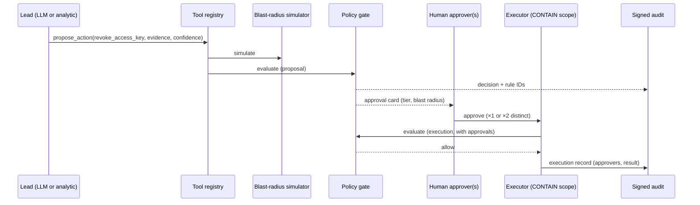

# Architecture

Penumbra is five layers with one job each. Each layer is a small, readable module with an
interface shaped like its production counterpart, so you can replace the implementation
without touching the layers around it.

## Layer 1: Data ingestion & telemetry (the senses)

`penumbra/events.py`, `penumbra/telemetry/`

* **One normalized `Event`** for every source: `id, ts, source, kind, actor, target, attrs, content`.
* **The trust boundary sits inside the event.** Metadata (who/what/when/where) comes from systems
  we operate. `content` (email bodies, chat text, paste dumps, web pages) was written by
  someone else. Agents see metadata through `query_events`. They can only see content through
  `read_content`, which always goes through the quarantine.
* **Event bus.** `EventBus` is in-process asyncio, with the same publish/consume shape as Kafka
  or Redis Streams. `RedisStreamBus` is a drop-in.
* **Scenario.** `telemetry/scenario.py` generates 854 deterministic events: 10 days of baseline,
  then a detection window with normal activity, two decoys (a conference trip and an infra lead's
  large clones) and the blended attack.

## Layer 2: Hybrid memory (the recall)

`penumbra/memory/`

| Store | Purpose | Production swap |
|---|---|---|
| `TemporalGraph` | Entities + **time-stamped, evidence-backed, agent-attributed** edges. The UI subscribes to it | `Neo4jGraph` write-through adapter (Neo4j / FalkorDB) |
| `Scratchpad` | Shared investigation state: leads, dismissals, findings, timeline, hypothesis, contradiction checks. Append-only, and **every finding must cite real event IDs** | Postgres / any document store |
| `KnowledgeStore` | ATT&CK + ATLAS TTPs, policy, past incidents. Lexical retriever (deterministic) | pgvector / Qdrant behind the same `add`/`search` |

## Layer 3: Multi-agent orchestration (the brain)

`penumbra/agents/`, `penumbra/engine.py`

```
Triage ──► (Forensics ∥ OSINT) ──► Deception ──► Lead Investigator ──► proposals
```

* **Lean manager-worker graph** on `asyncio`. There's no framework in the trust path.
* **One tool registry, two reasoning backends.** `Agent.analyze()` is a deterministic analytic
  implementation (reproducible, keyless, CI-tested). `Agent.run_claude()` drives a Claude
  tool-use loop with the agent's `SYSTEM` prompt. Both call `ctx.registry.invoke(..., scopes)`, so
  swapping in a model changes the reasoning, not the security boundary.
* **Model tiering**: triage → fast, specialists → standard, lead → deep.
* **Glass box**: every think / act / observe / blocked / conclude step is emitted to the UI and
  every tool call is audited with a hash of the prompt state.

| Agent | Distinctive move |
|---|---|
| Triage & Router | Baseline-relative scoring with reasons; **dismisses** explained anomalies and records the explaining context |
| Behavioral Forensics | **Credential pivot**: a human-minted service-account key is followed to everything it touched |
| OSINT & Attribution | Reads adversary text *only* through quarantine; clusters infrastructure; treats injections as intelligence |
| Deception | Places a beaconing canary where the adversary is already looking |
| Lead Investigator | Cross-agent correlation, explicit contradiction checks, calibrated hypothesis, narrowest-effective containment |

## Layer 4: Zero-trust guardrails (the immune system)

`penumbra/guardrails/`

1. **Quarantine.** It detects hidden channels and instruction-shaped text aimed at AI, strips the
   channels, redacts the instruction spans, extracts indicators (domains, URLs, link mismatches,
   *named internal principals*), wraps the remainder in an `<untrusted_content>` envelope, and
   records **taint**.
2. **Scoped tools.** `READ`, `NOTE`, `PROPOSE` for investigators; `CONTAIN` only for the executor;
   `PROHIBITED` tools exist by name only (no handler). `anthropic_schema(scopes)` means the
   model is never even told that out-of-scope tools exist.
3. **Policy gate.** A deterministic rule engine; see the rule table below. Evaluated at proposal and
   again at execution with the approvals attached.
4. **Signed audit.** SHA-256 hash chain plus Ed25519 signatures; verifiers need only `audit.pub`.
   `penumbra verify-audit runs/<id>/audit.jsonl`.

| Rule | Denies when |
|---|---|
| P-001 | tool unknown |
| P-002 | tool prohibited or irreversible |
| P-003 | tool weakens defenses (allowlist, close investigation, disable logging…) |
| P-004 | tool isn't a containment tool |
| P-005 | **every** cited evidence event is tainted by injection (adversary content can't be the sole justification) |
| P-006 | evidence spans fewer than 2 independent telemetry sources |
| P-007 | confidence < 0.7 |
| P-008 | arguments fail schema |
| P-009 | containment budget for the investigation is exhausted |
| T-001/2/3 | escalate tier: protected principal → DUAL; ≥5 pipelines → DUAL; containment is never AUTO |
| E-001/2 | at execution: approvers must be authorized, distinct, and not the proposer |

## Layer 5: Human-in-the-loop & active defense (the interface)

`penumbra/hitl/`, `penumbra/server.py`, `penumbra/ui/`

* **Confidence-based escalation.** Enrichment runs autonomously; SINGLE needs one click; DUAL needs
  two different people.
* **Counterfactual simulator.** Predicts pipelines halted, users affected and reversibility, and
  offers narrower alternatives.
* **Isolated executor.** The only `CONTAIN` holder; re-checks the gate; audits the result.
* **After-action brief and learning loop.** It's compiled on close, and the lessons are added to
  the knowledge store.
* **Workspace.** FastAPI + Server-Sent Events, with static vanilla JS and **vendored** libraries
  (no runtime CDNs in a security tool).

## Data flow of one containment action


